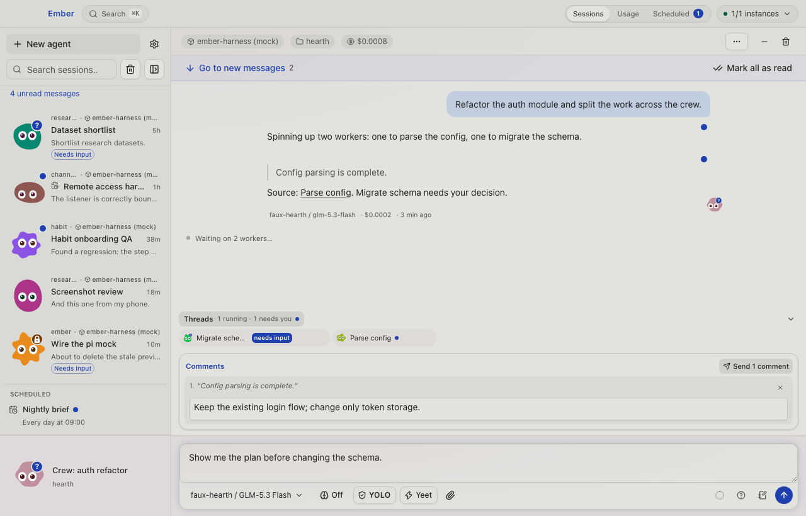

# Ember

**The human thinks, decides and steers.**

Ember is a desktop workspace for building with AI agents. Follow their work, give specific feedback,
and decide what happens next, with chats from your computers and projects in one window.

[Download](#downloads--quick-install) · [First use](#first-use) · [Build from source](#run-from-source) · [Contribute](docs/development.md#contributing)



*Current development UI, running locally with sample conversations. The comment and message are
unsent: the person decides when to send them. Published releases may show an earlier interface.*

## Downloads & quick install

Get the desktop app from [GitHub Releases](https://github.com/noemit/ember-bots/releases/latest).
The latest published release checked for this README is **v1.6.9**; the source tree contains newer
work. [Build from source](#run-from-source) to try the current development version.

| Platform | Download |
| --- | --- |
| macOS, Apple Silicon | [Ember DMG](https://github.com/noemit/ember-bots/releases/latest) — open it and move Ember to Applications |
| Linux, x64 | [AppImage or tar archive](https://github.com/noemit/ember-bots/releases/latest) |
| Windows, x64 | [Windows workflow](https://github.com/noemit/ember-bots/actions/workflows/windows.yml) — open a successful run and download and extract `ember-windows-x64`, then run the installer inside |

On Linux, give the downloaded AppImage execute permission in its file properties, then launch it.

**Windows signing warning:** Windows builds are currently unsigned. Microsoft Defender SmartScreen
may show “Windows protected your PC” or an unknown publisher. If you downloaded the installer from
the workflow above and trust this build, choose **More info → Run anyway** when offered.
Your organisation’s policy or Smart App Control may block installation without that option.
See [Microsoft’s explanation of signing and SmartScreen](https://learn.microsoft.com/windows/apps/package-and-deploy/smartscreen-reputation).

The desktop app includes **Kiln**, Ember’s agent harness. It starts when Ember starts; you do not
need to clone a repository, run a server, or paste a local connection token to get started.
Model access comes from the provider account you connect.

## First use

1. **Open Ember.** Its included Kiln appears as **This computer**.
2. **Connect a provider.** Follow setup to sign in to a supported provider or add an API key, then
   confirm the default model. You can change this later in **Settings → Providers**.
3. **Choose your workspace.** Pick the folder where your projects or work already live. Choose a
   project inside it, or work directly in that folder.
4. **Start a chat.** Choose **New agent**, confirm the project and model, and send a prompt. For
   example: “Inspect this project and propose a plan before making changes.”
5. **Review and steer.** Read the response, select a passage to comment on, or send your next
   direction. Comments stay in a draft until you send them.

Quitting Ember stops its included Kiln and active agent work; conversation history stays on disk.
On macOS, closing the window leaves the app running. For work that should continue after Ember
quits, use a [standalone Kiln](docs/instances.md#standalone-kiln-with-tinder).

## What it does

- **Recognize a chat at a glance.** Each chat has a stable creature, colour and name. Blobs are
  mnemonic devices: they help you find the conversation you remember. Their movement shows work,
  thinking, questions and errors. Appearance and size are adjustable when you want more control.
- **Keep track of what you’ve read.** A read mark records your acknowledgement. Opening a chat does
  not mark its messages read. **Go to new messages** finds unread replies; individual bubbles and
  **Mark all as read** let you clear them deliberately. Tool steps need no read receipt.
- **Give feedback on the exact passage.** Select part of a plan or response, add a comment, and
  collect several comments before sending them together. The agent gets the quoted text with
  your feedback.
- **Follow background work without repeated reports.** In the current source, new Kiln threads
  store their outcomes without copying routine reports into the main chat. A **Threads** tray
  shows progress and requests for your input. Source links in quoted findings open the worker’s
  conversation. **Ultra delegator** keeps substantial execution in background threads while
  leaving the foreground available for direction. This requires Kiln **1.9.0 or later**; existing
  workers retain their earlier delivery policy.
- **Reveal detail when you need it.** Tool output and thinking can stay folded. Queued messages,
  notes, threads and running processes live in trays above the composer. Drafts stay with their
  chats; optional split view shows conversations side by side.

## Using the workspace

Other chats sit in the rail, with newer activity toward the bottom. The active chat’s creature
sits beside the composer. Select another chat to bring its identity into that corner; double-click
its name there to rename it. A chat you minimize stays available in the rail.

Use the composer to send, queue a follow-up, attach an image, or save a thought for later. Change
conversation text size in **Settings → General**. Display controls let you reveal reasoning,
tools and message details as needed.

[Keyboard controls and local data](docs/usage.md) · [Connections and remote access](docs/instances.md)

## Run from source

You need **Node.js 22.12+**, **Bun 1.4.2** (pinned in [package.json](package.json)), and a graphical
desktop environment for Electron.

```sh
git clone https://github.com/noemit/ember-bots.git
cd ember-bots
bun install
bun install --cwd packages/kiln
bun run dev
```

This builds Kiln and the desktop app, then launches Ember with its own local Kiln. You should see
setup or your existing workspace. `dev` builds and launches; it is not a hot-reload command.

For an isolated development profile alongside your daily app:

```sh
EMBER_DATA_DIR=/tmp/ember-canary bun run dev
```

For a browser-only preview with synthetic sessions:

```sh
bun run dev:web
```

Open `http://localhost:5179`. This preview uses a mock bridge and does not connect to your real
instances. See [development and verification](docs/development.md) for checks, packaging and
architecture.

## Optional setups

<details>
<summary>Other computers, standalone Kiln, OpenChamber and browser access</summary>

Ember can connect to additional Kilns in **Settings → Instances**, and can discover HTTP endpoints
already configured in OpenChamber. Ember owns its included Kiln’s lifetime; connecting to another
Kiln does not give it ownership of that process.

- [Run Kiln independently with Tinder](docs/instances.md#standalone-kiln-with-tinder).
- [Connect another local or remote Kiln](docs/instances.md#connecting-another-kiln).
- [Connect OpenChamber](docs/instances.md#connecting-openchamber).
- [Use Ember from a browser over Tailscale](docs/instances.md#remote-access).

Available operations depend on the connected host and its version. Private Relay instances are
not currently supported.

</details>

## Development and verification

[Contributor guide](docs/development.md) · [Kiln wire contract](packages/kiln/README.md) · [Changelog](CHANGELOG.md)

The contributor guide covers local checks, browser and native testing, packaging, and how the
renderer, desktop process and harness fit together. Repository invariants live in [AGENTS.md](AGENTS.md).

## Troubleshooting

- **This computer is not answering:** open **Settings → Instances** to inspect the local Kiln’s
  status, then use **Instances → Reprobe instances** after it is available again.
- **Your model is unavailable:** use **Refresh models** or choose an available model in the picker.
  Your draft and explicit choice are kept until you decide what to use.
- **The browser shows sample chats:** `dev:web` is the UI preview. For your real chats, use the
  desktop app or enable its [remote access](docs/instances.md#remote-access).

## License

[MIT](LICENSE), copyright Noemi Titarenco. The vendored [README Atlas skill](.agents/skills/readme-atlas/LICENSE)
has its own MIT copyright notice.

> Documentation note: this README was drafted with AI assistance and has not yet been proofread
> by the maintainer.
